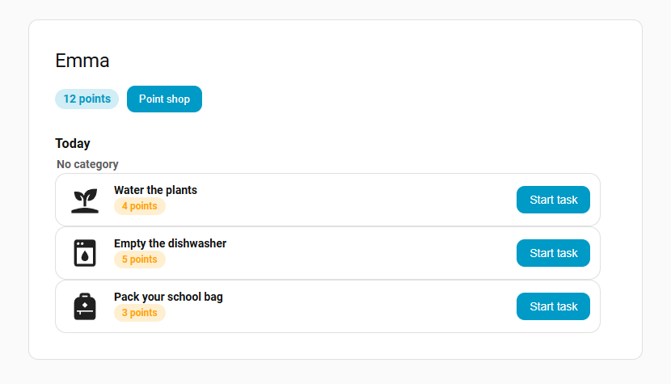

# Chores4Kids

 

Give each child a Home Assistant dashboard where they can start chores, earn points and choose rewards. Parents assign tasks and approve completions. The integration and all three dashboard views come in one package.

## [Open the user guide](https://qlerup.github.io/chores4kids/)

[Getting started](https://qlerup.github.io/chores4kids/getting-started/installation.html) | [Feature guides](https://qlerup.github.io/chores4kids/card/features/index.html) | [Integration actions](https://qlerup.github.io/chores4kids/integration/services.html) | [Troubleshooting](https://qlerup.github.io/chores4kids/troubleshooting.html)

### Where do I find it?

| Task | Start here |
| --- | --- |
| Use a family reward name or show chores in columns | [Shared parent and child card settings](https://qlerup.github.io/chores4kids/card/features/appearance.html#set-a-family-reward-name-and-task-layout) |
| Let a child record the same chore twice today | [Multiple completions per day](https://qlerup.github.io/chores4kids/card/features/tasks.html#complete-a-chore-several-times-a-day) |
| Use a drawing or a custom icon on a task | [Upload an icon](https://qlerup.github.io/chores4kids/card/features/appearance.html#upload-your-own-artwork) |
| Change approval colors on the child dashboard | [Status colors](https://qlerup.github.io/chores4kids/card/features/appearance.html#change-status-colors) |
| Set one card to Dutch or Turkish | [Card language](https://qlerup.github.io/chores4kids/card/internationalization.html) |
| Let a child spend points | [Reward shop](https://qlerup.github.io/chores4kids/card/features/rewards.html) |

New to the card? Follow [Create your first family dashboard](https://qlerup.github.io/chores4kids/getting-started/quick-start.html) to add a child, assign a chore and approve it.

[Play the task completion demo in the user guide](https://qlerup.github.io/chores4kids/getting-started/quick-start.html#complete-the-first-task)

[Releases and downloads](https://github.com/qlerup/chores4kids/releases) | [Report an issue](https://github.com/qlerup/chores4kids/issues) | [Support the project on Ko-fi](https://ko-fi.com/qlerup) | [Guide source](docs/index.md)
