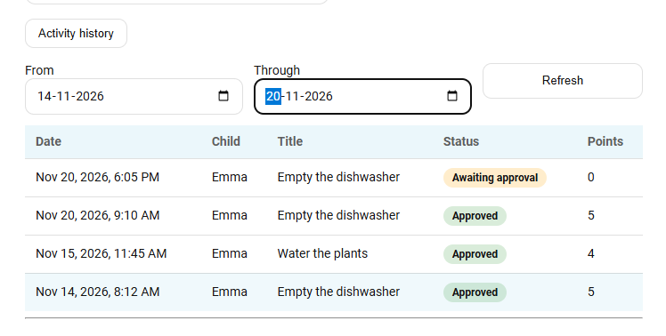

# Activity history

Open **Activity history** below **Finished tasks** on the parent card. The initial view covers today and the previous six days in Home Assistant’s time zone.

## Review a family week

Set **From** to Saturday and **Through** to Friday. Both dates are included. The list shows the child, task, completion time, approval status and awarded points, newest first. Each completion has its own row. In the example, Emma emptied the dishwasher twice on Friday. The morning completion earned five points and the evening one still awaits approval.

[Play walkthrough](../../images/review-activity.gif) | [Full-size GIF](../../images/review-activity.gif)

## How to read the result

- The date follows **when the child completed the chore**. An approval the following morning updates the points on the original completion date.
- **Deadline missed** shows the deduction at the configured deadline, including its negative point value.
- **Awaiting approval** shows zero awarded points. Once approved, the main task shows the amount it actually earned, including early and time bonuses. An approved bonus task has a separate row.
- Home Assistant keeps approved completions across midnight, restarts and deletion of the source task. Later edits to a child’s name or task title leave the approved record as it was.
- On upgrade, the integration imports approvals still present with a recorded date. A dash means the exact past award was never stored. Completions already removed before the upgrade cannot be recovered.

Automations can request the same dates with the [activity history action](../../integration/services.md#read-activity-history).
