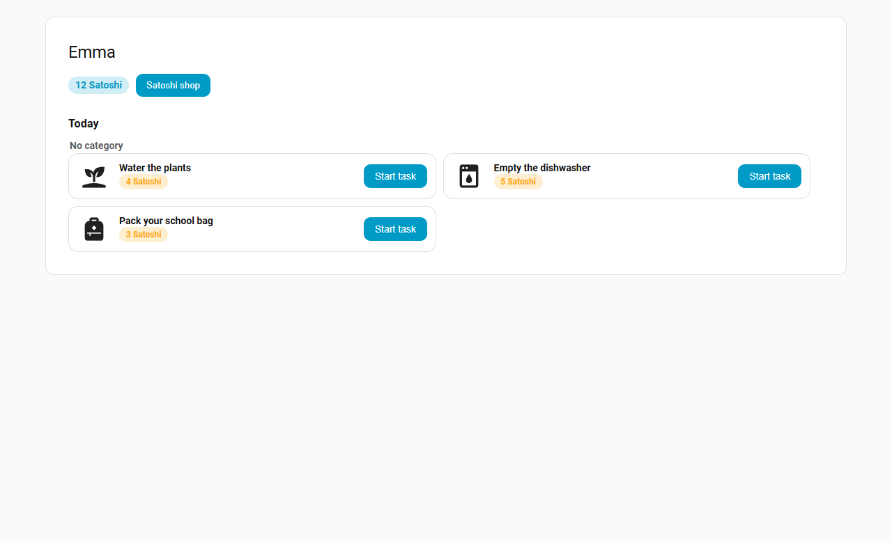
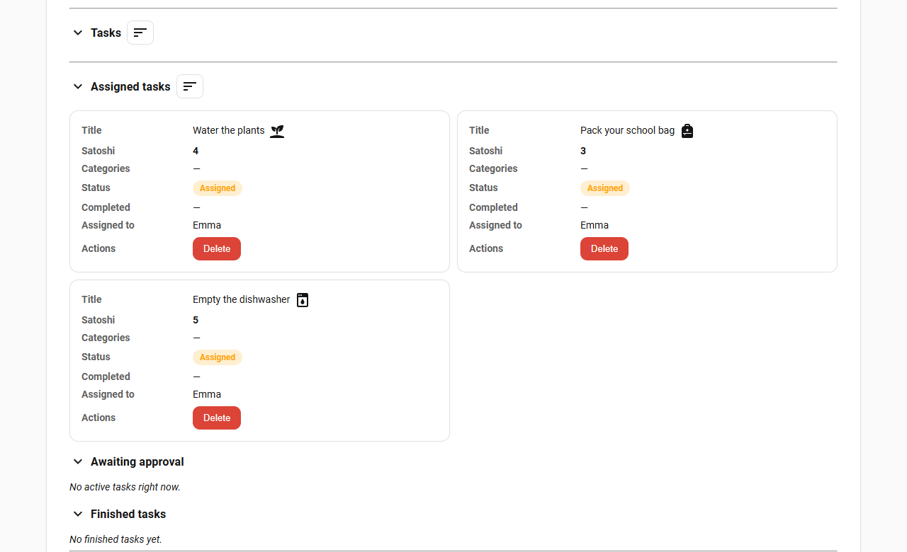
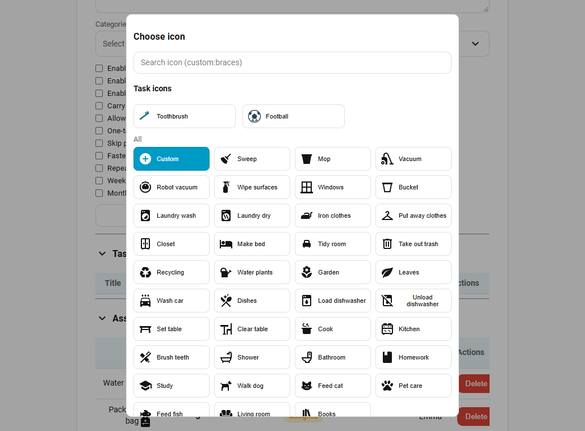
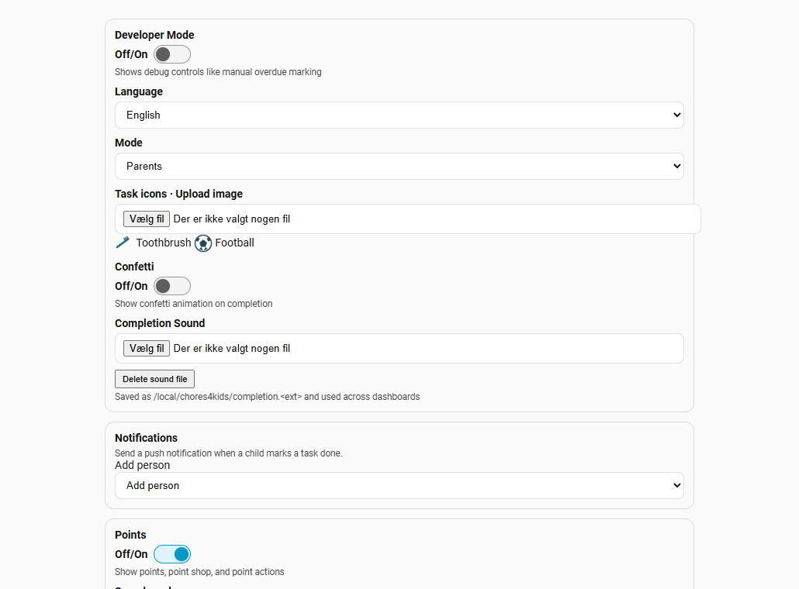
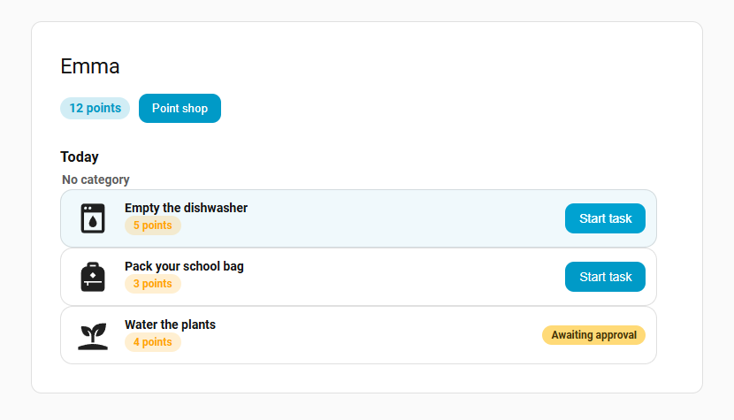

# Task icons and appearance

## Set a family reward name and task layout

Edit the **parent card**. In **Reward unit name**, enter the name your family uses, such as *Satoshi* or *Stars*, and leave the field to save it. Home Assistant shares it with the parent, child and overview cards, including dashboards already open on other devices. Look for the new name on Emma’s balance, task rewards, bonuses, shop prices and the parent’s points controls. Clear the field to restore each card’s translated default.

Under **Task columns**, select **Auto**, **1**, **2** or **3**. One choice covers the family. Each card measures its own available width. Auto allows up to three columns, and a number sets the maximum. A narrow card shows one column even on a wide dashboard. Categories remain full-width headings, and a bonus stays with its main task.

[Play walkthrough](../../images/family-task-settings.gif) | [Full-size GIF](../../images/family-task-settings.gif)

## Upload your own artwork

1. Edit the **parent dashboard card** and open **Task icons → Upload image**. Select an SVG, PNG, JPEG or WebP. The filename becomes its label.
2. In the parent card's task form, open **Choose icon**. Look under **Task icons**, or search for the filename.
3. Select the image, then create or update the task. Open the child card to see it beside the task title.

The integration saves a 128 × 128 PNG in Home Assistant and shares the library across dashboards. Transparent areas are preserved.

[Play walkthrough](../../images/upload-an-icon.gif) | [Full-size GIF](../../images/upload-an-icon.gif)

## Use an installed icon pack

Enter a complete identifier such as `custom:braces` into the icon picker. Select the preview and save the task. Home Assistant must already have that icon pack available. Built-in Material Design icons use the `mdi:` prefix.

## Change status colors

Open **Parent card editor → Colors**. Expand **Awaiting approval**, **Taken** or **Approved** and choose both a background and a text color. Use **Clear** on either field to restore its default. Parent status badges and corresponding child and bonus statuses use the same colors. Start and complete buttons have their own controls.

[Play walkthrough](../../images/set-status-colors.gif) | [Full-size GIF](../../images/set-status-colors.gif)

## Completion feedback

Enable confetti in the parent editor and upload a completion sound if desired. The integration shares the sound across dashboards. Use **Delete sound file** to remove it. In the editor you can also adjust child task title, point and button text sizes for wall displays.
