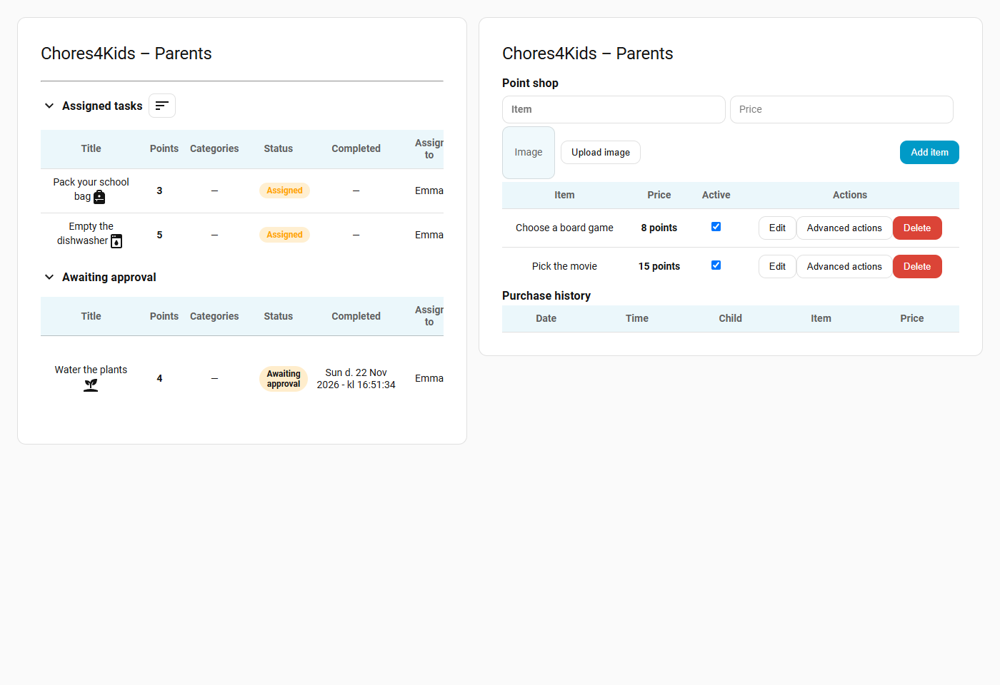
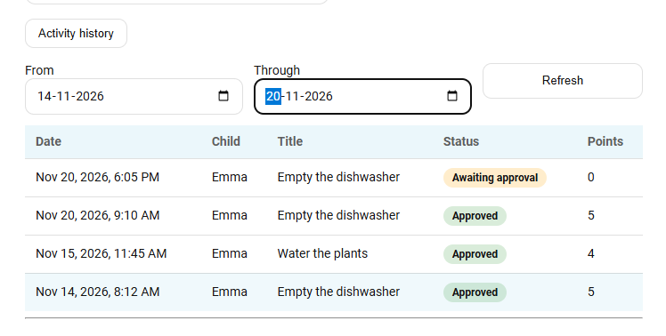
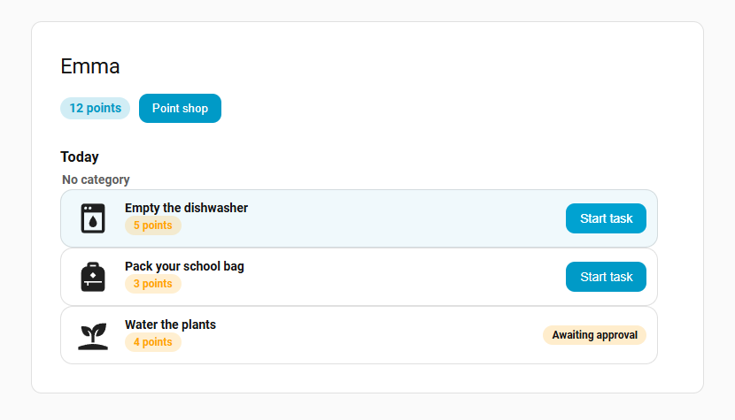
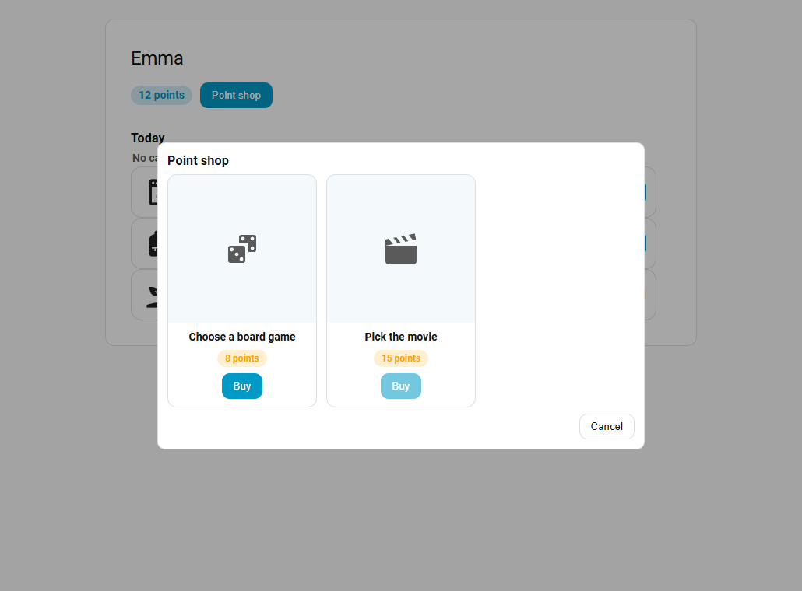
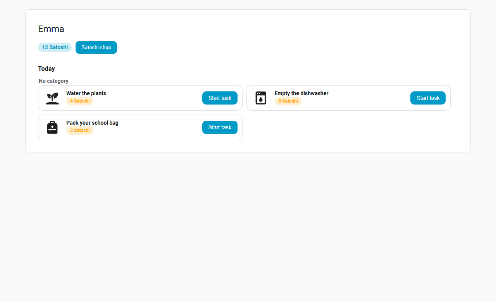
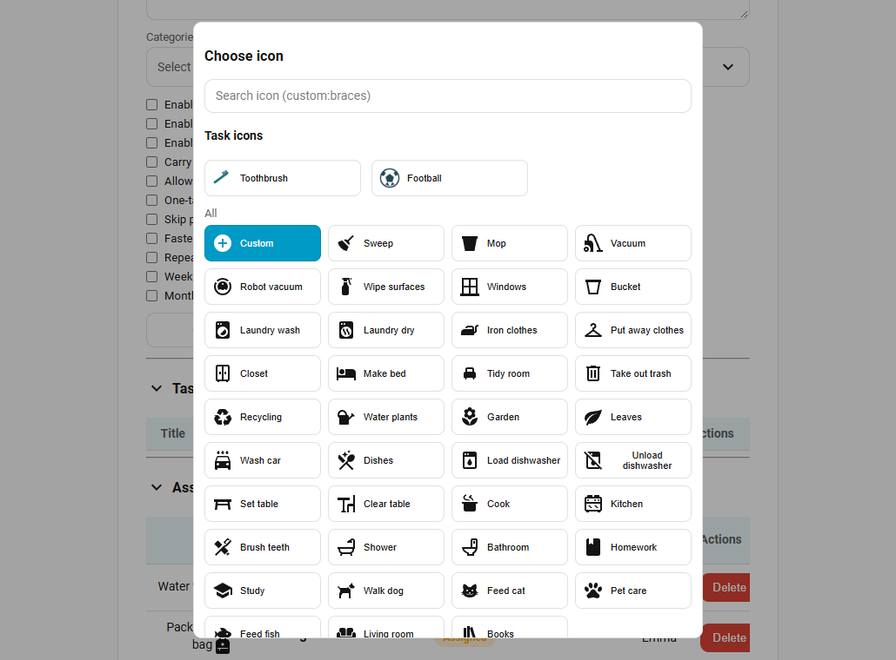
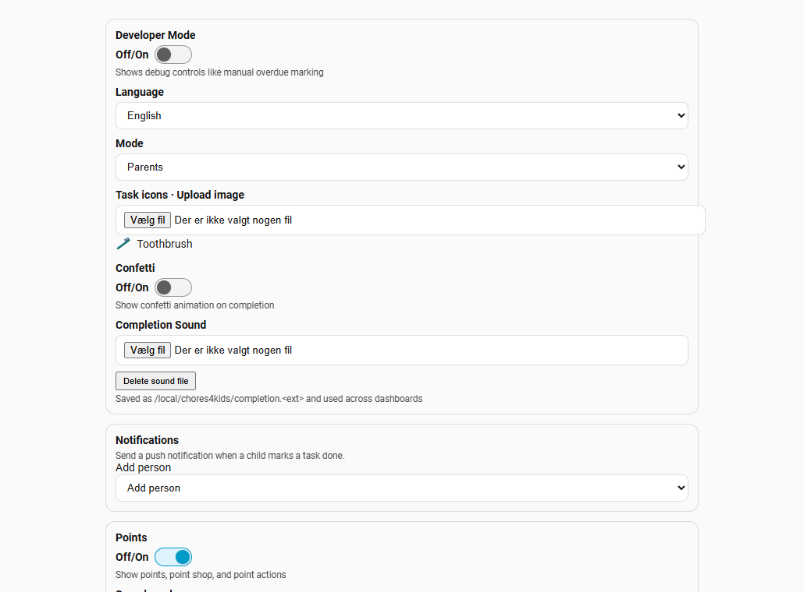

# Feature guides

Choose a task below, or use **Find a feature or page** in the navigation. Each animated preview opens on a still image.

## Chores and rewards

-   **[Split a parent dashboard into widgets](parent-widgets.md)**

    Put assigned chores and approvals together, and manage rewards on a separate card.

    

    [Play walkthrough](../../images/configure-parent-widgets.gif) | [Full-size GIF](../../images/configure-parent-widgets.gif)

-   **[Review completed chores for a date range](activity-history.md)**

    Select a Saturday-to-Friday week and see each child’s completed tasks, approvals and earned points.

    

    [Play walkthrough](../../images/review-activity.gif) | [Full-size GIF](../../images/review-activity.gif)

-   **[Complete and approve a task](tasks.md)**

    Follow the child's start and finish actions, then approve the occurrence on the parent card.

    

    [Play walkthrough](../../images/complete-a-task.gif) | [Full-size GIF](../../images/complete-a-task.gif)

-   **[Spend points in the reward shop](rewards.md)**

    Create a reward, buy it from the child card and review the purchase.

    

    [Play walkthrough](../../images/buy-a-reward.gif) | [Full-size GIF](../../images/buy-a-reward.gif)

-   **[Receive completion and purchase notifications](notifications.md)**

    Choose which mobile devices receive a message and which events they receive.

## Customize a dashboard

-   **[Set a family reward name and task layout](appearance.md#set-a-family-reward-name-and-task-layout)**

    Choose the unit and task columns in the parent editor and see both settings take effect across dashboards.

    

    [Play walkthrough](../../images/family-task-settings.gif) | [Full-size GIF](../../images/family-task-settings.gif)

-   **[Choose or upload task icons](appearance.md#upload-your-own-artwork)**

    Use artwork shared across the family's dashboards.

    

    [Play walkthrough](../../images/upload-an-icon.gif) | [Full-size GIF](../../images/upload-an-icon.gif)

-   **[Choose a card language](../internationalization.md)**

    Follow the viewer’s profile or choose a fixed language for one card.

    

    [Play walkthrough](../../images/card-language.gif) | [Full-size GIF](../../images/card-language.gif)

-   **[Set status colors](appearance.md#change-status-colors)**

    Choose a background and text color for waiting, taken and approved tasks.

