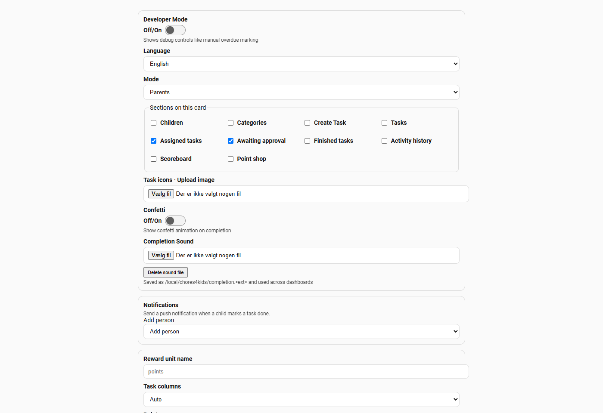
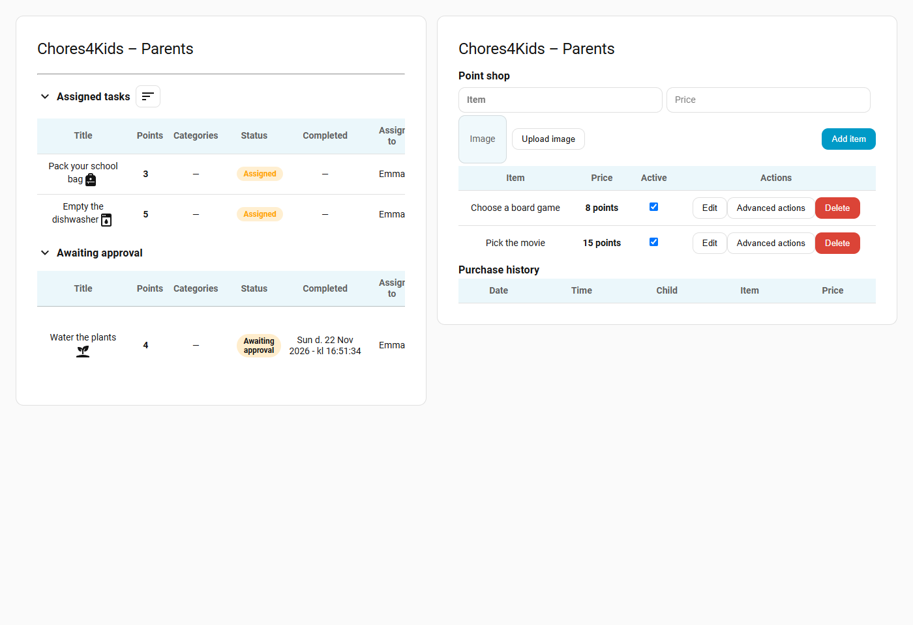

# Parent widgets

Add a **Chores4Kids** card to your dashboard and choose **Parents** mode. Under **Sections on this card**, keep **Assigned tasks** and **Awaiting approval** selected. Save the card. You can now check progress and approve completed chores from one place.



Add a second parent card and select just the shop to manage rewards and see purchases directly on the dashboard. A third card on a setup dashboard can hold children, categories and task creation. Each card saves its own selection. All of them read and update the same family records.

[](../../images/configure-parent-widgets.gif)

[Play walkthrough](../../images/configure-parent-widgets.gif) | [Full-size GIF](../../images/configure-parent-widgets.gif)

## YAML example

```yaml
type: vertical-stack
cards:
  - type: custom:chores4kids-card
    mode: admin
    admin_sections: [assigned, approvals]
  - type: custom:chores4kids-card
    mode: admin
    admin_sections: [shop]
```

Available sections are `children`, `categories`, `create`, `tasks`, `assigned`, `approvals`, `finished`, `history`, `scoreboard` and `shop`. The shop and scoreboard require points to be enabled. Omit `admin_sections` to use the full parent card with its usual shop button.
