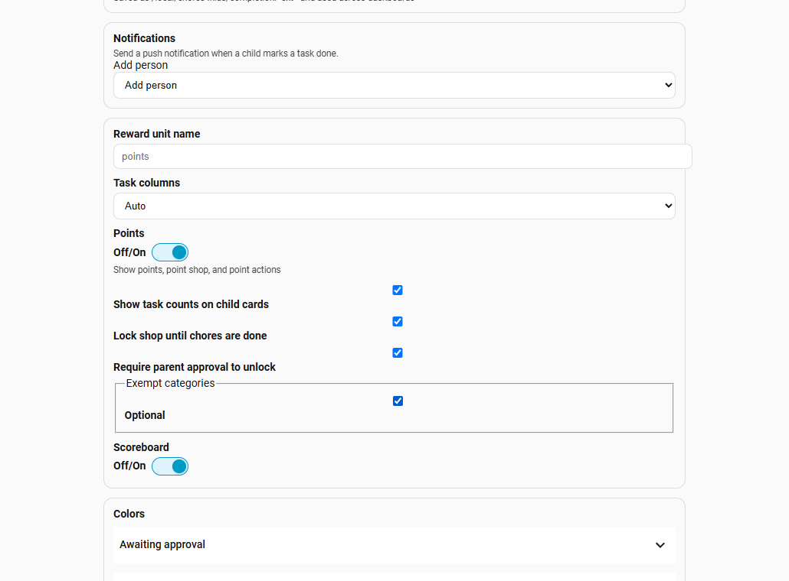
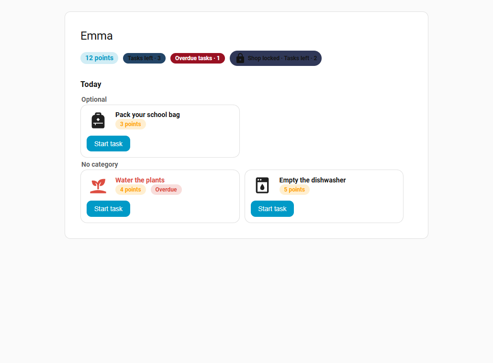
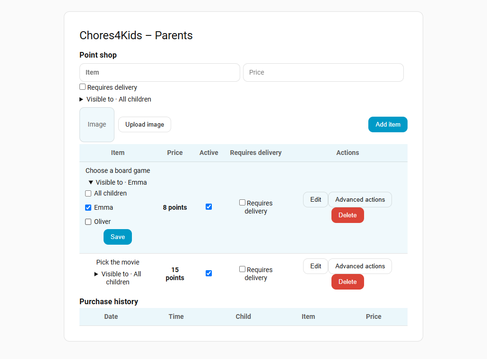
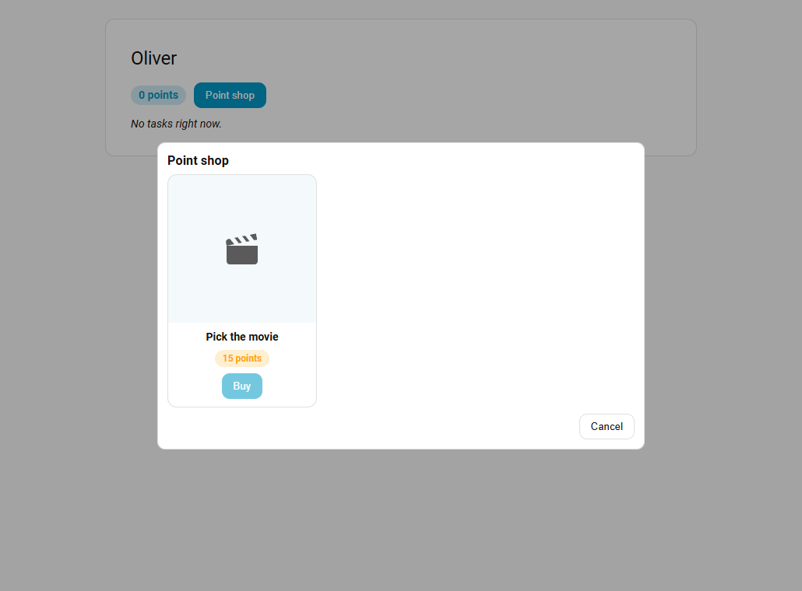
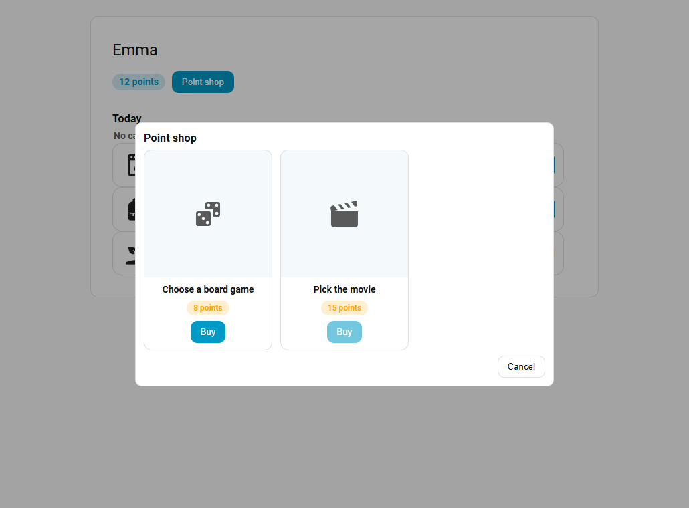
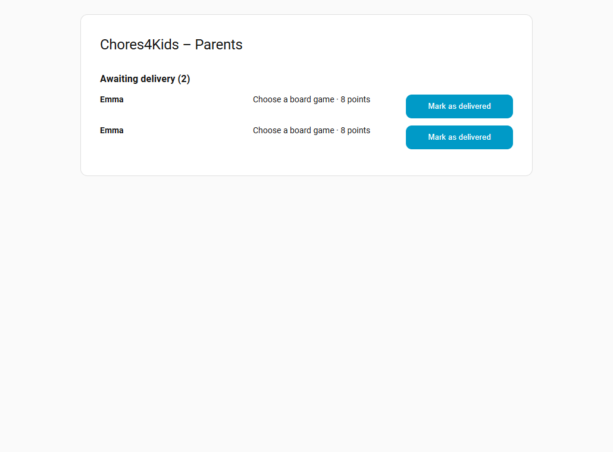

# Rewards and points

## Set up the shop

Select **Open shop** on the parent card. Add a title and price, then choose an icon or upload an image. Keep the item **Active** while it is available. For example, offer *Choose a board game* for eight points and *Pick the movie* for fifteen.

## Unlock the shop after chores

In the parent card editor, enable **Lock shop until chores are done**. Each child can open their shop as soon as they mark their last required chore complete. Enable **Require parent approval to unlock** if a parent should review it first. Select **Exempt categories** for optional activities such as drawing. These settings apply across dashboards.

Turn on **Show task counts on child cards** to show unfinished chores and how many are overdue. The counters also work with the shop lock or the points system turned off. An exempt chore still appears in the unfinished count. The lock indicator shows how many required chores or approvals are holding up the shop. Bonus subtasks, extra opportunities to repeat a completed chore that day and tasks claimed by a sibling do not block purchases.

[Play walkthrough](../../images/unlock-the-shop.gif) | [Full-size GIF](../../images/unlock-the-shop.gif)

Both the lock and the counters start switched off. In **Parent card editor → Colors**, expand **Tasks left**, **Overdue tasks** or **Shop locked** to choose background and text colors independently. **Clear** restores the theme default.

## Choose who sees a reward

In the parent shop, open **Visible to** on a reward. Select one or more children and press **Save**. When creating a new reward, make the selection before pressing **Add item**. The default **All children** includes children added later. Selecting it again makes an existing reward available to everyone.

In the example, Emma can choose a board game or pick the movie. Oliver sees only the shared movie reward. You can change the selection at any time. Previous purchases stay in the purchase history.

[Play walkthrough](../../images/choose-shop-children.gif) | [Full-size GIF](../../images/choose-shop-children.gif)

## Buy a reward

On the child card, select **Point shop**. Choose **Buy** next to an affordable reward. The balance decreases by its price. Open **Purchase history** on the parent card to see the child, item and purchase time.

[Play walkthrough](../../images/buy-a-reward.gif) | [Full-size GIF](../../images/buy-a-reward.gif)

## Hand over a reward

In the parent shop, tick **Requires delivery** when adding a reward, or switch it on beside an existing item. Use it for rewards a parent hands over, such as a board game. Leave it off for instant rewards such as extra screen time. The setting applies to future purchases.

When a child buys a tracked reward, the parent card lists the purchase under **Awaiting delivery**. Select **Mark as delivered** when you hand it over. Two purchases of the same reward have separate buttons. Purchase history shows the handover time and the child can see the status in their own shop.

[Play walkthrough](../../images/hand-over-a-reward.gif) | [Full-size GIF](../../images/hand-over-a-reward.gif)

To create a dedicated handover card, select only **Awaiting delivery** in the parent editor. Clearing purchase history retains rewards still awaiting delivery. Existing purchases stay in history when you turn on tracking for an item.

## Run actions on purchase

Edit a reward’s **Advanced actions** to add Home Assistant service calls and delays in order. For a timed reward, select a switch you control, turn it on, insert a 30-minute delay and turn the same switch off. Buy the reward from a test child’s card to check the sequence before offering it to the family.

## Manage points

Use the parent card’s child controls to add, subtract or reset points. Show the scoreboard to let the family see the ranking. The parent editor’s **Points** switch controls the points interface, including the shop and point actions.
