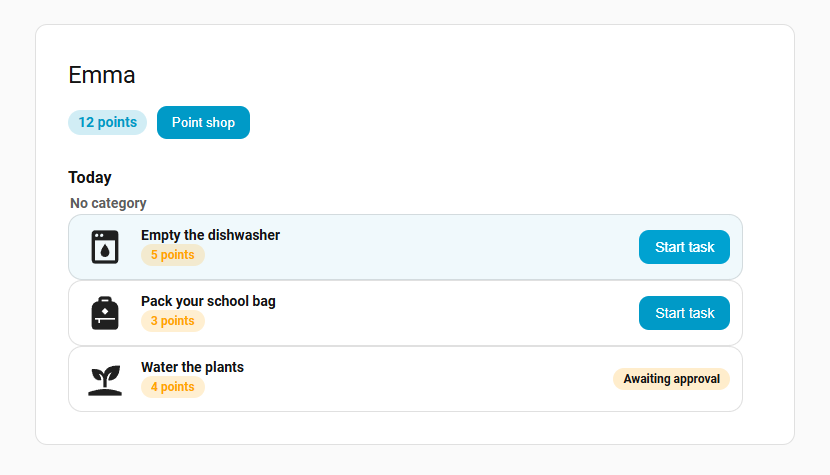
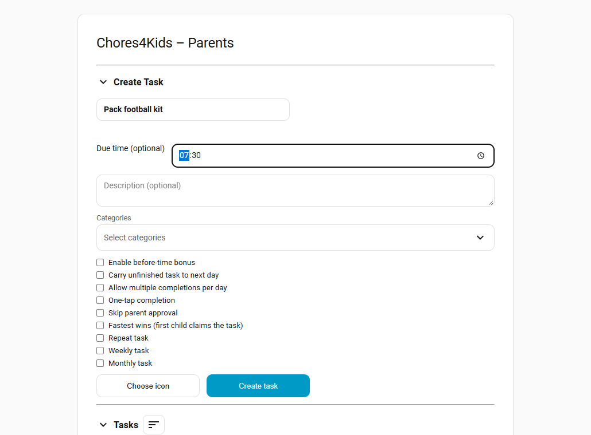
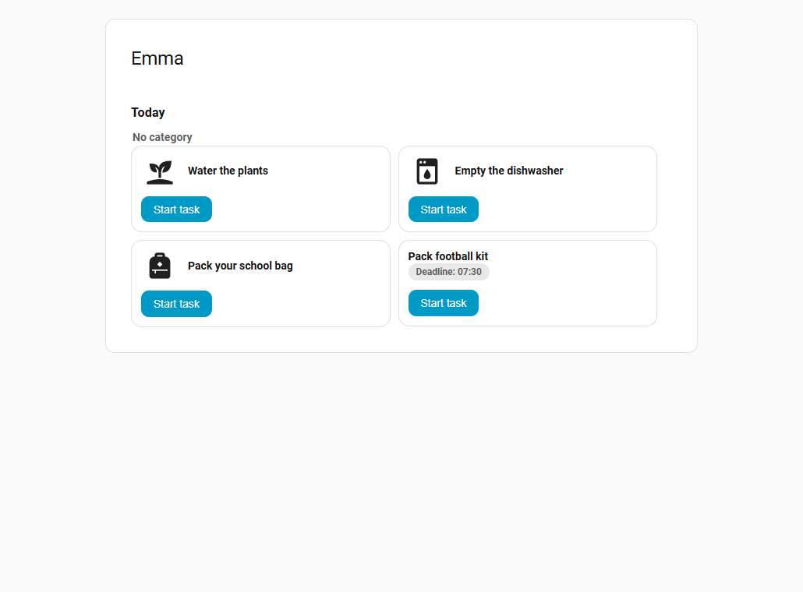
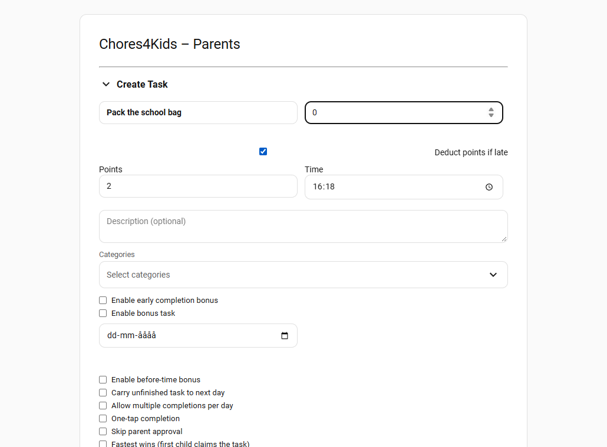
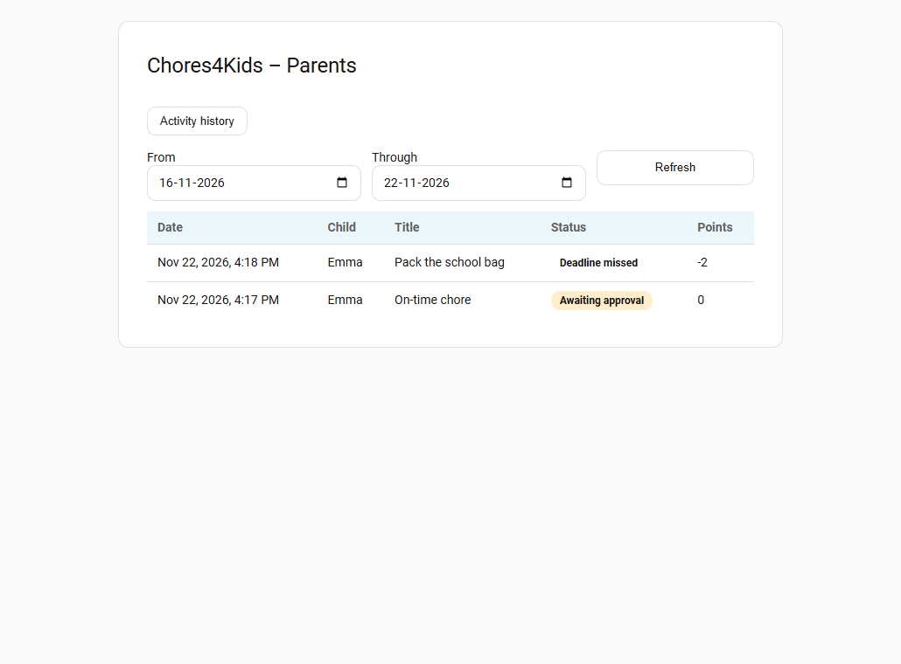
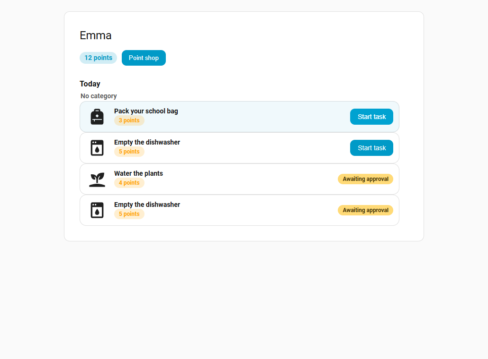

# Tasks and schedules

## Assign a task

In the parent card, create a task with a title and point value. Give it a description if the child needs instructions. Choose a category and icon to help them find it. Assign the task to a child. Its reusable template stays in the parent list.

The child selects **Start task** and then **Complete task**. The parent sees the completion time in **Awaiting approval**. Approving credits the child’s balance. Enable **One-tap completion** to combine the child’s two actions. Enable **Skip parent approval** to award points as soon as the child finishes.

[Play walkthrough](../../images/complete-a-task.gif) | [Full-size GIF](../../images/complete-a-task.gif)

## Set an optional due time

Leave **Due time (optional)** empty for a chore that can be done at any time. For a school-day chore such as *Pack football kit*, enter **07:30** and select the repeat days as usual. Each scheduled copy carries that time. Parents see it beside the task, and children see it on their own cards, even when points are switched off.

Edit the task and clear the time field to remove it. Setting a due time by itself does not deduct points. If you separately enable a deduction, its time field can override the task’s due time.

[Play walkthrough](../../images/set-task-due-time.gif) | [Full-size GIF](../../images/set-task-due-time.gif)

## Deduct points for a missed deadline

On the parent card, create or edit a task and enable **Deduct points if late**. Choose a positive whole number to deduct. The normal reward can be zero. Leave the deduction time empty to use the task’s due time, or the end of the day if both fields are empty, in Home Assistant’s time zone. Without a due date, the deadline falls on the assignment day. New and existing tasks start with deductions turned off.

For example, Emma starts with 12 points. Completing *Pack the school bag* by the deadline keeps her at 12, even if a parent approves it later. Missing the deadline takes her to 10. Each missed deadline appears once in **Activity history**, including after a restart. The full deduction applies even if it takes the balance below zero.

[Play walkthrough](../../images/deadline-deduction.gif) | [Full-size GIF](../../images/deadline-deduction.gif)

## Complete a chore several times a day

Turn on **Allow multiple completions per day** in the task form. For example, Emma can empty the dishwasher after breakfast and again after dinner. A fresh occurrence appears immediately after each completion. Each has its own ID and can be approved independently, even if the morning task is still waiting.

[Play walkthrough](../../images/repeat-a-chore.gif) | [Full-size GIF](../../images/repeat-a-chore.gif)

## Repeat on a schedule

Use **Repeat task** to choose weekdays and select children for automatic assignment. Use a weekly or monthly task for a longer schedule. The schedule determines the deadline when enabled. With auto-assignment active, the parent card can disable manual assignment for that template.

Home Assistant checks the schedule at startup and at local midnight. Awaiting approvals survive the daily cleanup. Use **Carry unfinished task to next day** and **Mark unfinished task as overdue** to control how unfinished work appears.

## Bonuses and shared tasks

- Add a bonus task with its own title and points. Complete the main task first, then the bonus. Parents can review the bonus along with the main completion.
- Set an early completion bonus against a deadline, or choose a time-of-day bonus such as finishing before breakfast.
- Use **Fastest wins** when several children can claim the same task. Once one child claims it, the others can see who took it.
- Create categories in the parent card and use the sorting controls to change their display order.
