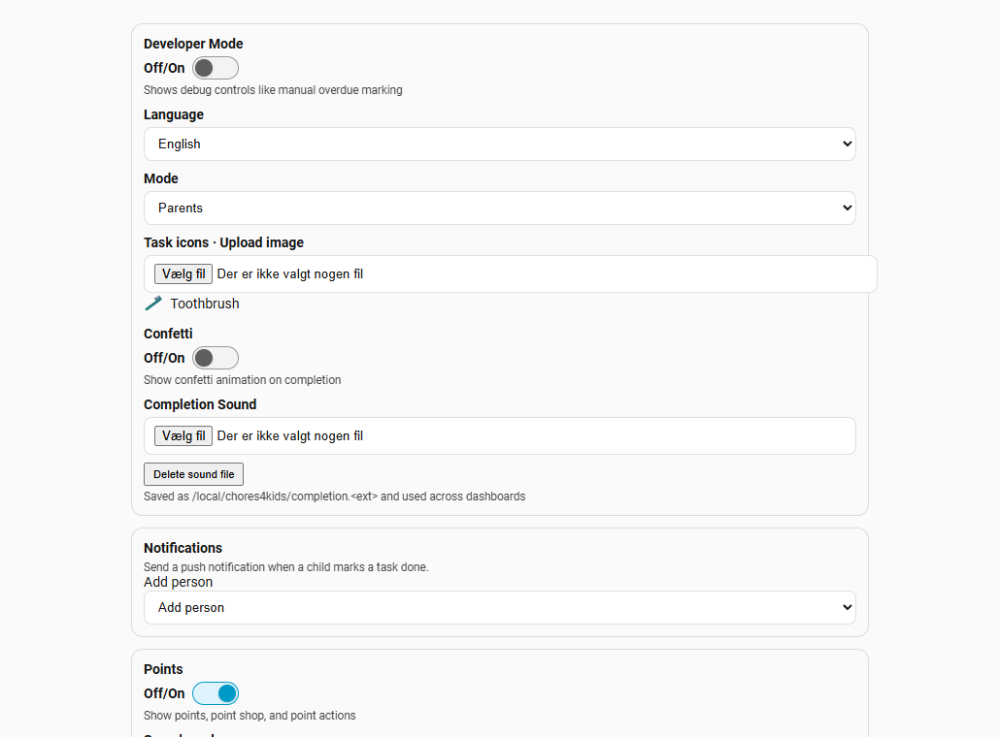

# Card languages

**Language → Auto detect** is the default on new and existing cards. It follows each viewer’s Home Assistant profile, including regional choices such as `nl-BE`, `nl-NL` and `tr-TR`.

To use a fixed language, edit that card and select its name in the language dropdown. For example, choose **Nederlands** on the child card and leave the parent card on Auto detect. Choose Auto detect again to follow the viewer’s profile. In YAML use `language: nl` or `language: auto`. Task and shop notifications use Home Assistant’s system language.

[Play walkthrough](../images/card-language.gif) | [Full-size GIF](../images/card-language.gif)

| Language | YAML value | Language | YAML value |
| --- | --- | --- | --- |
| Dansk | `da` | Deutsch | `de` |
| English | `en` | Español | `es` |
| Français | `fr` | Italiano | `it` |
| Nederlands | `nl` | Norsk bokmål | `nb` |
| Suomi | `fi` | Svenska | `sv` |
| Türkçe | `tr` | Auto detect | `auto` |
