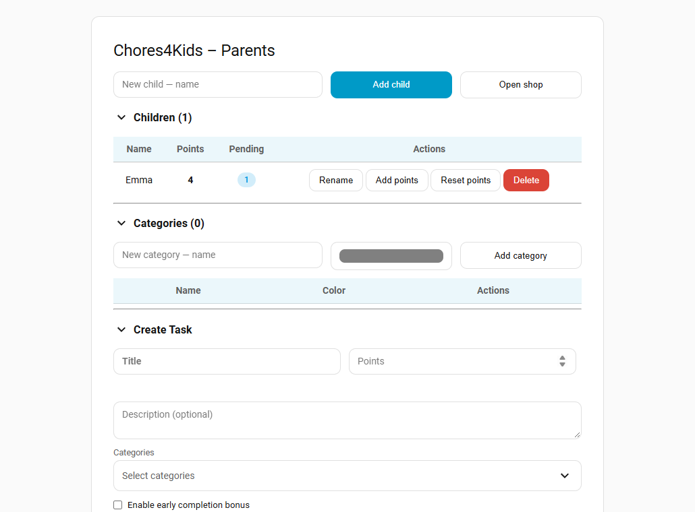
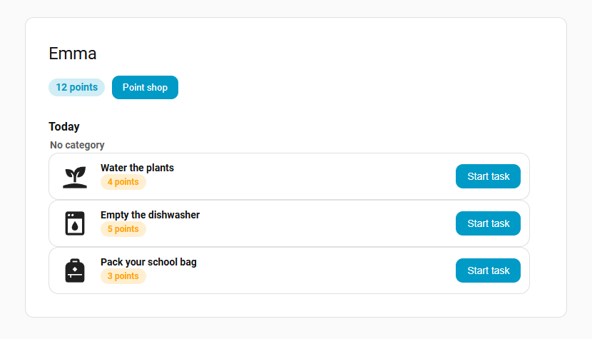

# Create your first family dashboard

## Set up the parent card

Add a Chores4Kids card in **Parents** mode. In **Children**, enter a name such as Emma and choose **Add child**. In **Create task**, enter *Water the plants* and **4** points. Create the task and assign it to Emma. The parent card shows who has the task and how many points await approval.

## Complete the first task

Add a second Chores4Kids card, choose **Kid** mode and select Emma. On her card, choose **Start task** and then **Complete task**. The task moves to **Awaiting approval**.

[Play walkthrough](../images/complete-a-task.gif) | [Full-size GIF](../images/complete-a-task.gif)

## Approve and check the balance

On the parent card expand **Awaiting approval**. Find Emma’s completion, check the time and approve the task. Her balance increases by four points. To let her spend them, [create a reward](../card/features/rewards.md). For a dashboard managed in YAML, copy the [card examples](../card/examples.md).
