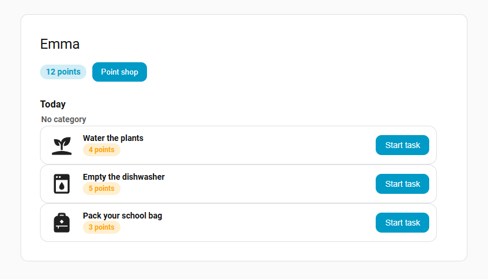

# Chores4Kids

Create a parent dashboard to assign chores and a child dashboard to complete them. Home Assistant stores assignments, approvals, points and purchases so the same family can use a wall tablet and a phone.

[Play walkthrough](images/complete-a-task.gif) | [Full-size GIF](images/complete-a-task.gif)

## Find a guide

| I want to… | Guide |
| --- | --- |
| Install the integration and dashboard card | [Installation](getting-started/installation.md) |
| Go from an empty dashboard to my first approval | [Quick start](getting-started/quick-start.md) |
| Set up recurring chores or bonuses | [Tasks and schedules](card/features/tasks.md) |
| Add rewards and optional actions on purchase | [Reward shop](card/features/rewards.md) |
| Change language, icons or colors | [Languages](card/internationalization.md) · [Appearance](card/features/appearance.md) |
| Use a task in an automation | [Integration actions](integration/services.md) |
| Restore a missing card after an upgrade | [Troubleshooting](troubleshooting.md) |

## Explore the card

Browse the [visual feature directory](card/features/index.md). Choose **Play walkthrough** below a screenshot to see the steps, then choose **Show still image** to read the result. The screenshots show an example family in Home Assistant. Features shown here follow the main branch and may be awaiting the next [release](https://github.com/qlerup/chores4kids/releases).
